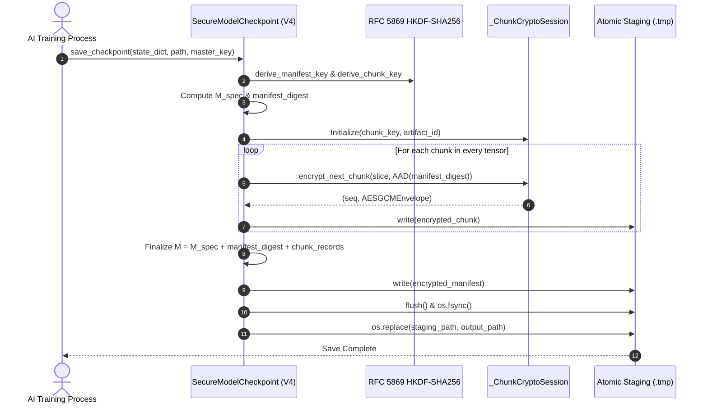

# Phase 4 Nonce and Protocol Security Audit

**Document:** `reports/PHASE4_NONCE_AND_PROTOCOL_AUDIT.md`  
**Date:** 2026-10-26  
**Auditor:** Senior Applied Cryptographer & Systems Security Auditor  
**Cryptographic Target:** `ahcc/checkpoint.py`, `ahcc/secure.py` (Version 4 Hardened Protocol)  
**Standard Compliance:** NIST SP 800-38D (AES-GCM), RFC 5869 (HKDF), RFC 5116 (AEAD)  

---

## 1. Nonce Protocol Audit & Flaw Correction

### The Birthday Bound Flaw in Truncated Hashing
In Phase 3 documentation, chunk nonces were described as:
$$\text{Nonce}_{\text{chunk}} = \text{BLAKE2b-96}(\text{salt} \parallel \text{tensor\_name} \parallel \text{chunk\_idx}_{64\text{BE}})$$
with the claim that this construction *mathematically guarantees* uniqueness.

**Cryptographic Correction:**
A truncated 96-bit cryptographic hash output does *not* provide a mathematical guarantee of uniqueness. Under the birthday paradox, the probability of at least one collision among $M$ randomly or hash-generated 96-bit nonces is approximately:
$$P(\text{collision}) \approx 1 - \exp\left(-\frac{M^2}{2 \times 2^{96}}\right) = 1 - \exp\left(-\frac{M^2}{2^{97}}\right)$$
For $M = 2^{48}$ chunks (an extreme theoretical multi-exabyte checkpoint), collision probability reaches $\approx 50\%$. While $2^{48}$ is large, calling any 96-bit hash output "mathematically collision-free" is scientifically incorrect and violates NIST SP 800-38D.

### The Phase 4 Deterministic Monotonic Counter Construction
Phase 4 completely replaces arbitrary or hashed nonces with a deterministic, auditable 96-bit counter construction compliant with NIST SP 800-38D Section 8.2.1:

```
+------------------------------------+------------------------------------+
| Fixed Prefix: b"CHNK" (4 bytes)    | Monotonic Counter: uint64_be (8 B) |
+------------------------------------+------------------------------------+
|<-------------------------- 96 bits (12 bytes) ------------------------->|
```

1. **Prefix:** Fixed 4-byte ASCII domain tag `b"CHNK"` (`0x43 0x48 0x4E 0x4B`).
2. **Counter:** Monotonically increasing 64-bit big-endian unsigned integer sequence number ($0, 1, 2, \dots, N-1$).
3. **Overflow Guard:** Strictly checked before every encryption operation:
   ```python
   if self._seq >= 2**64 - 1 or self._seq >= self._max_chunks:
       raise CheckpointError("Chunk sequence counter overflow.")
   ```
4. **Uniqueness Property:** Under a given `chunk_key`, every single chunk receives a strictly unique nonce by construction. Collision probability within an artifact under `chunk_key` is **identically 0**.

---

## 2. Cryptographic Domain Separation via HKDF-SHA256

Under NIST SP 800-38D, reusing a nonce under the *same key* is catastrophic, resulting in the complete recovery of the authentication hash subkey $H$ and plaintext forgery.

Phase 4 guarantees cryptographic domain separation by deriving independent 256-bit keys from the master key using RFC 5869 HKDF-SHA256:

```
                            Master Key (256-bit)
                                     |
                                     v
                        Salt (256-bit, os.urandom)
                                     |
                                     v
                           HKDF-Extract (SHA-256)
                                     |
                                    PRK
                                     |
            +------------------------+------------------------+
            |                                                 |
            v                                                 v
  Info: "AHCC-v4-Manifest-Key::" + ID         Info: "AHCC-v4-Chunk-Key::" + ID
            |                                                 |
            v                                                 v
   Manifest Key (256-bit)                            Chunk Key (256-bit)
            |                                                 |
   Used ONLY for Manifest                            Used ONLY for Payload Chunks
 Nonce: b"MANI\x00\x00\x00\x00\x00\x00\x00\x00"     Nonces: b"CHNK" + uint64_be
```

- **Manifest Key Isolation:** Even if a chunk sequence number were somehow identical, the keys are mathematically independent. The output of HKDF with distinct info strings is indistinguishable from independent random functions under the PRF assumption of HMAC-SHA256.
- **Manifest Nonce:** Encrypted exactly once per artifact with a fixed 12-byte nonce:
  $$\text{Nonce}_{\text{manifest}} = b\text{"MANI"} \parallel b\text{"\x00\x00\x00\x00\x00\x00\x00\x00"}$$
  Since `manifest_key` is used for exactly one encryption operation across its entire lifecycle, a fixed 96-bit nonce is fully compliant with NIST SP 800-38D Section 8.2.1.
- **Per-Artifact Freshness:** Every save operation generates a fresh 32-byte salt (`os.urandom(32)`) and fresh 16-byte artifact identifier (`secrets.token_bytes(16)`). The probability of salt collision across two artifacts is $2^{-256} \approx 8.6 \times 10^{-78}$.

---

## 3. Manifest Specification & AAD Binding (Eliminating Circular Dependencies)

### Circular Dependency Audit
In naive authenticated formats, a circular dependency often occurs if:
1. Manifest contains chunk ciphertext hashes.
2. Chunk AAD binds the manifest ciphertext hash.
Neither can be computed first!

### Phase 4 Non-Circular Solution: Manifest Specification ($\mathcal{M}_{\text{spec}}$)
Phase 4 decomposes the manifest into two distinct cryptographic entities:
1. **Manifest Specification ($\mathcal{M}_{\text{spec}}$):** Contains all deterministic plaintext layer metadata (tensor names, dtypes, shapes, element sizes, declared chunk counts, and chunk sequence ranges).
2. **Final Manifest ($\mathcal{M}$):** Extends $\mathcal{M}_{\text{spec}}$ with `manifest_digest` and chunk ciphertext metadata (byte offsets, ciphertext lengths, plaintext SHA-256 digests).

```
[ Step 1: Pre-Scan & Compute M_spec ]
  names, dtypes, shapes, chunk counts -> canonical_json(M_spec)
                                              |
                                              v
                              manifest_digest = SHA-256(canonical_json(M_spec))

[ Step 2: Stream-Encrypt Chunks ]
  Chunk Plaintext + AAD(artifact_id || manifest_digest || tensor || seq || idx || offset || raw_len)
  -> AES-GCM(chunk_key, b"CHNK" + seq)
  -> Chunk Ciphertext + Tag

[ Step 3: Finalize and Encrypt Manifest ]
  M = M_spec + manifest_digest + [ {seq, ciphertext_len, sha256}, ... ]
  -> canonical_json(M)
  -> AES-GCM(manifest_key, b"MANI\x00...", AAD: artifact_id || "::MANIFEST::v4")
  -> Encrypted Manifest Envelope
```

### Save and Load Sequence Diagram



---

## 4. Verification & Fail-Closed Guarantees

During `load_checkpoint`:
1. **Container Header Verification:** Reads `MAGIC_V4 = b"AHCCMOD4"`, `VERSION_V4 = 4`, 32-byte salt, artifact ID.
2. **Manifest Decryption:** Manifest envelope decrypted via `manifest_key` and verified against `artifact_id + b"::MANIFEST::v4"`. Any bit-flip raises `CheckpointError`.
3. **Strict JSON Parsing:** Decoded manifest parsed using strict hook rejecting duplicate JSON keys.
4. **Specification Integrity Verification:** $\mathcal{M}_{\text{spec}}$ is reconstructed from the manifest dictionary, serialized to canonical JSON, and verified against `manifest["manifest_digest"]` using constant-time comparison `secrets.compare_digest`.
5. **Chunk Streaming Verification:**
   - Every chunk sequence number is checked for monotonic equality ($seq == \text{expected\_seq}$).
   - Chunk AAD binds the verified `manifest_digest`, tensor name, sequence number, chunk index, byte offset, and slice length.
   - Slices decrypted directly into preallocated layer buffer.
6. **Trailing Byte Detection:** The stream must terminate exactly at the declared end of the final chunk. Any extra bytes raise `CheckpointError`.
